# Proses Bisnis Asset Management System

## A. Login

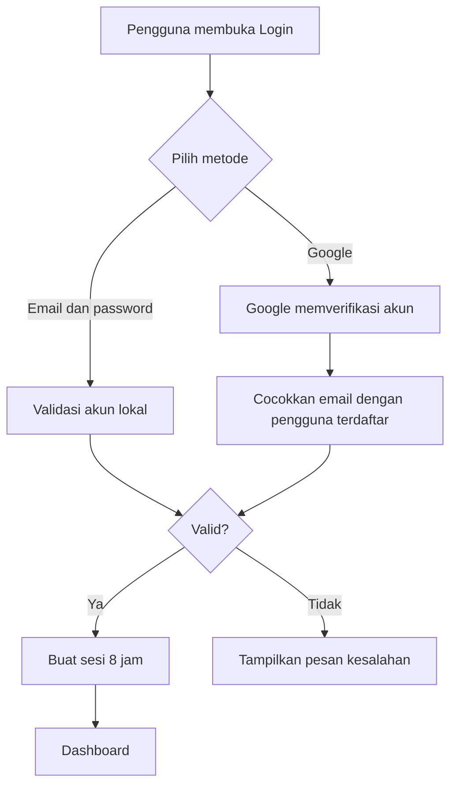

Google Login tidak membuat akun baru. Role dan permission selalu diambil dari data pengguna lokal. Logout menghapus cookie sesi.

### Lupa Password

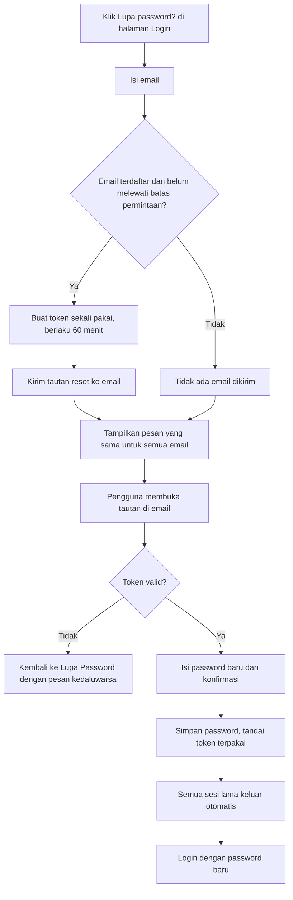

Pesan setelah permintaan selalu sama agar sistem tidak membocorkan email mana yang terdaftar. Hanya hash token yang disimpan di database. Permintaan baru membatalkan token lama, dan setiap akun dibatasi maksimal 3 permintaan per 15 menit. Email dikirim lewat SMTP (`MAIL_MAILER=smtp`); di development dengan `MAIL_MAILER=log`, tautan dicetak ke console server.

## B. Tambah Asset

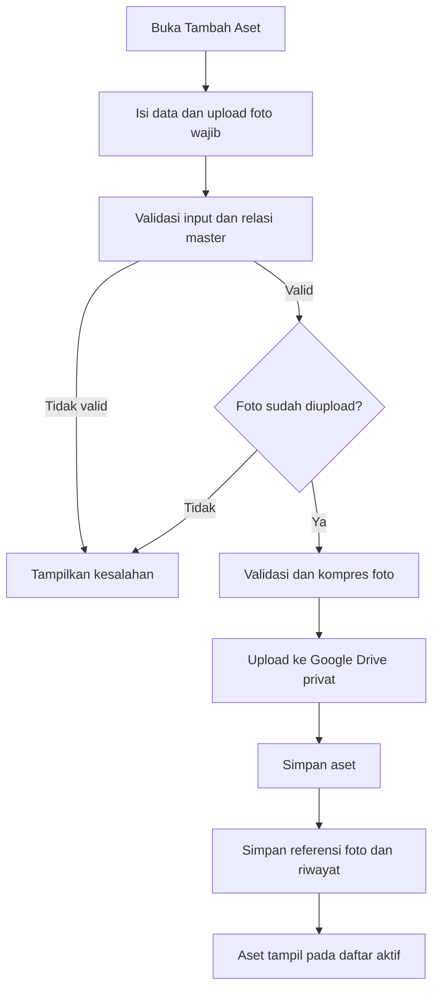

Foto wajib diupload; aset tidak bisa disimpan tanpa foto. Kode dan QR token harus unik. Jika penyimpanan foto gagal, aset tidak boleh menyimpan referensi file yang tidak valid. Jika penyimpanan database gagal setelah upload, sistem berusaha membersihkan file yang tidak terpakai.

## C. Edit Asset

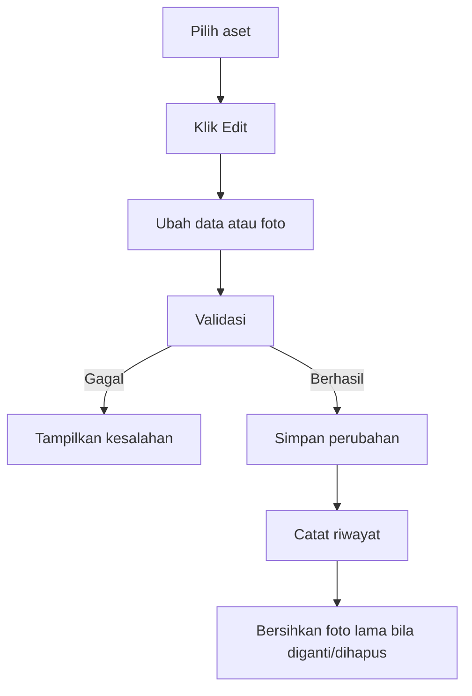

Foto baru diproses menjadi WebP dengan sisi terpanjang maksimal 1600 px dan kualitas sekitar 78%. Foto lama baru dijadwalkan/dihapus setelah referensi baru tersimpan.

## D. Delete Asset

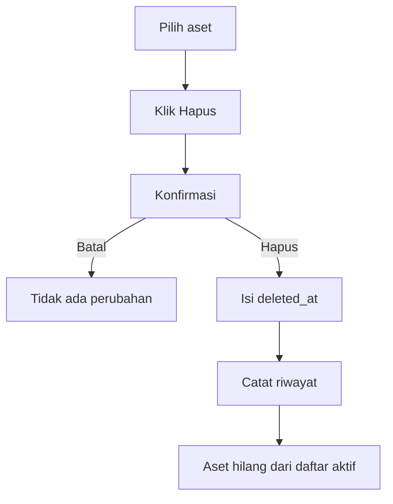

Delete menggunakan **soft delete**. Data aset, foto, dan riwayat tidak langsung dihapus permanen. Aset yang dihapus tampil di tab **Dihapus** pada menu Archive dan bisa dipulihkan atau dihapus permanen dari sana.

## E. Archive Asset

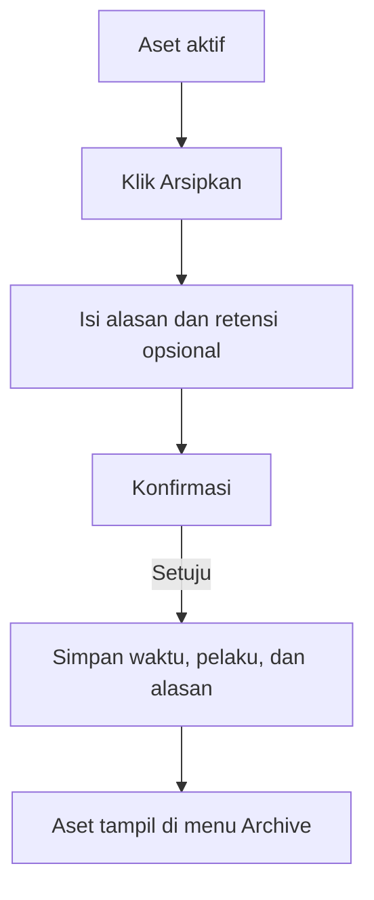

Archive dipakai untuk aset yang tidak lagi aktif secara operasional tetapi masih perlu disimpan. Archive tidak sama dengan delete.

## F. Restore Asset

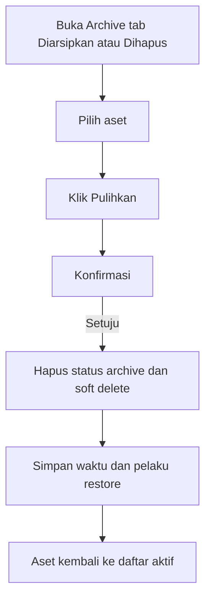

Restore berlaku untuk aset yang diarsipkan maupun yang dihapus (soft delete).

### Hapus Permanen

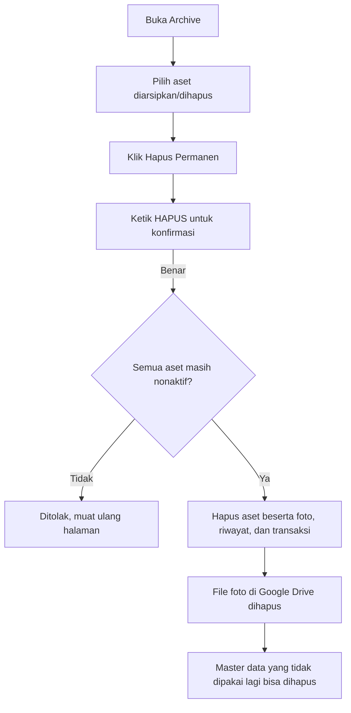

Hapus permanen tidak bisa dibatalkan dan hanya untuk aset di Archive. Aset aktif harus diarsipkan atau dihapus dulu. Master data (status, kategori, lokasi, departemen, dan lainnya) tidak bisa dihapus selama masih dipakai aset mana pun, termasuk aset di Archive; pesan error menyebut jumlah aset di Archive yang perlu dihapus permanen.

## G. Import Asset

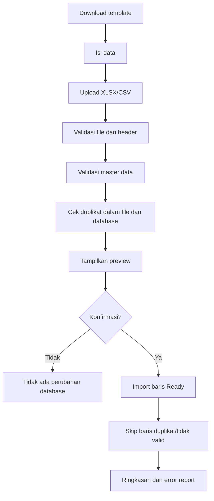

Import bersifat parsial: baris valid diproses, sedangkan duplikat dan invalid dilewati. Kode aset lama tidak ditimpa. Nama master dari file dipetakan ke ID database; nilai yang tidak ditemukan gagal dan tidak membuat master baru.

## H. Bulk Action

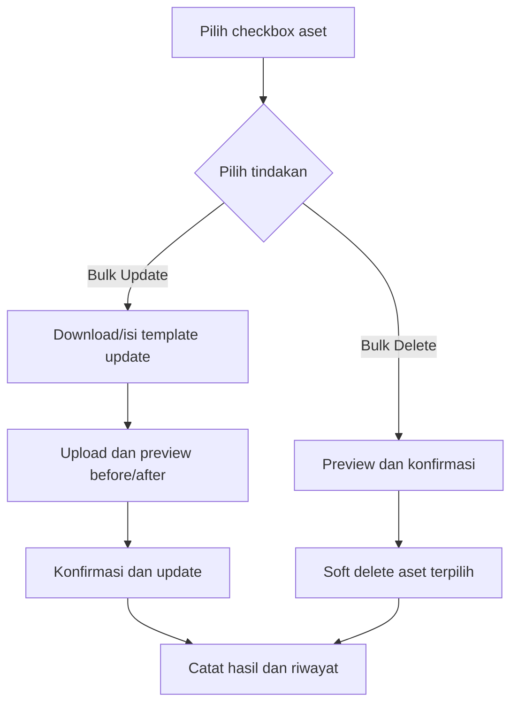

Select all hanya memilih data yang tampil/dimuat. Bulk update dibatasi pada aset yang dipilih saat template dibuat. Perubahan aset oleh proses lain setelah preview menyebabkan baris terkait ditolak agar data baru tidak tertimpa.

## I. Approval

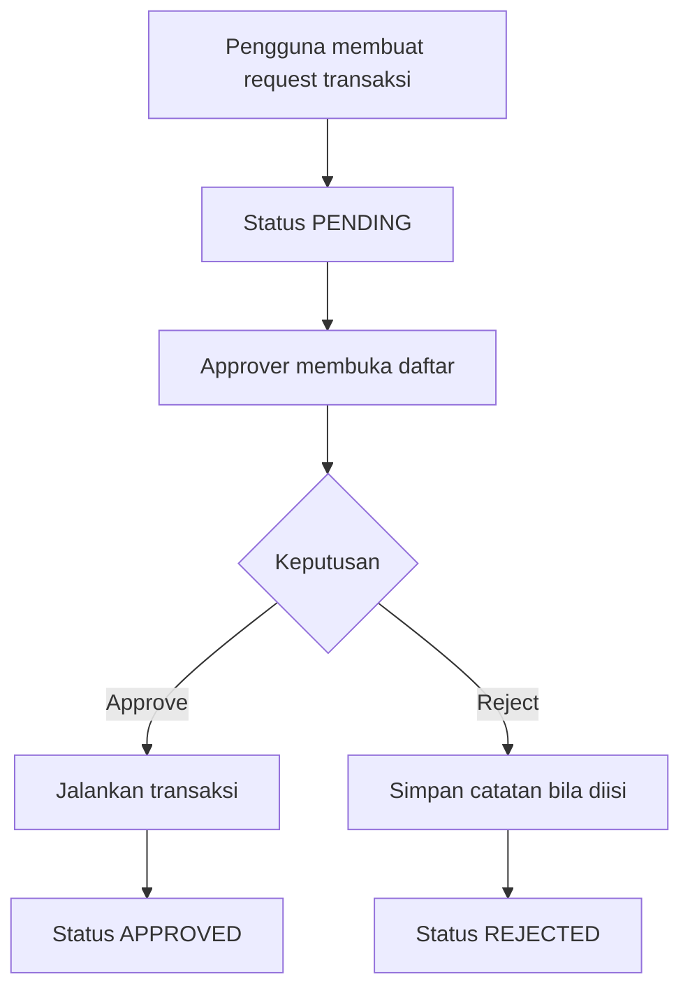

Jenis request yang didukung adalah movement, disposal, dan maintenance. Reviewer serta waktu review disimpan. Pencegahan self-approval tidak ditemukan secara tegas dan perlu dikonfirmasi sebelum modul digabungkan.

## J. Asset Lifecycle

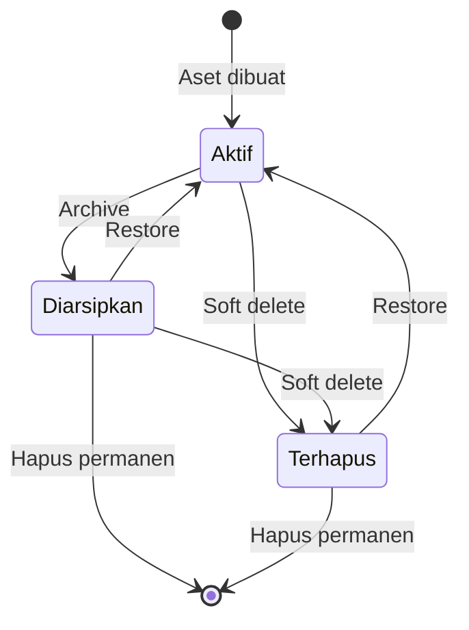

Status master seperti Aktif, Maintenance, atau Rusak menggambarkan kondisi operasional. `archived_at` mengatur lifecycle arsip, sedangkan `deleted_at` mengatur soft delete; ketiganya merupakan konsep yang berbeda.

## K. Movement

Pengguna memilih aset, menentukan lokasi/department/asset user tujuan, tanggal, dan catatan. Setelah diproses, sistem menyimpan kondisi asal dan tujuan lalu memperbarui penempatan aset. Permission yang digunakan adalah `movements.manage`.

## L. Disposal

Disposal mencatat aset yang dihentikan penggunaannya beserta tanggal dan alasan. Permission yang digunakan adalah `disposals.manage`.

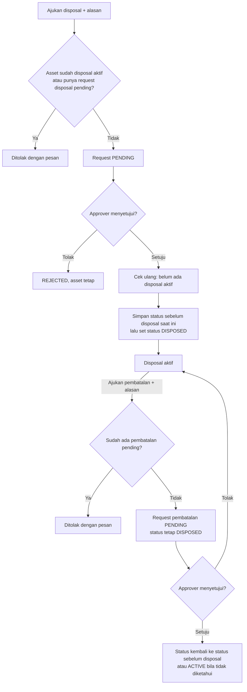

Aturan konsistensi:

- Satu asset hanya boleh punya **satu** disposal aktif dan **satu** request disposal pending.
- Setiap pengajuan, approval, dan reverse mengunci baris asset, sehingga klik ganda atau dua approver bersamaan tidak menghasilkan disposal ganda.
- Status sebelum disposal direkam saat approval, bukan saat pengajuan.
- Pembatalan (reverse) disposal wajib alasan dan harus disetujui di Approvals, sama seperti disposal. Satu asset hanya boleh punya satu pengajuan pembatalan pending. Alasan, waktu, dan approver pembatalan tersimpan di data disposal dan riwayat asset.
- Reverse hanya mengembalikan status; lokasi dan department tidak diubah karena disposal tidak mengubahnya.
- Status `DISPOSED` hanya bisa diset lewat disposal yang disetujui dan hanya bisa dilepas lewat pembatalan disposal yang disetujui. Form edit asset dan bulk import/update menolak perubahan status yang melanggar aturan ini.
- Status `ACTIVE` dan `DISPOSED` adalah status sistem: tidak bisa dihapus atau diganti kodenya di master.
- Movement yang disetujui setelah asset didisposal ditolak.
- Dropdown aset di form Disposal dan Movement tidak menampilkan aset yang sudah disposed. Form Disposal juga menyembunyikan aset yang masih punya request disposal pending.

## M. Audit dan Maintenance

Audit mencatat hasil pemeriksaan aset (`MATCH`, `MATCHED`, `MISMATCH`, `MISSING`, atau `DAMAGED`), lokasi, tanggal, auditor, dan catatan. Maintenance mencatat deskripsi pekerjaan, status, jadwal/selesai, biaya, vendor, dan pembuat. Keduanya menyimpan riwayat per aset.
