# Struktur Database Asset Management System

Tipe ditulis mengikuti bentuk data database. `Yes` pada Required berarti kolom tidak nullable. Kolom relasi yang dihapus menggunakan perilaku `SetNull`, `Cascade`, atau `Restrict` sesuai keterangan relasi.

## Identitas dan Hak Akses

### Table: users

Fungsi: akun pengguna sistem.

| Field | Type | Required | Description |
|---|---|---:|---|
| id | UUID | Yes | Primary key |
| name | String | Yes | Nama pengguna |
| email | String | Yes | Email unik |
| email_verified_at | DateTime | No | Waktu verifikasi email |
| password | String | Yes | Password terenkripsi |
| remember_token | String | No | Token remember me |
| department_id | UUID | No | FK ke departments |
| asset_location_id | UUID | No | FK ke asset_locations |
| two_factor_enabled | Boolean | Yes | Penanda 2FA |
| two_factor_secret | String | No | Secret 2FA |
| two_factor_recovery_codes | JSON | No | Recovery codes 2FA |
| two_factor_confirmed_at | DateTime | No | Waktu konfirmasi 2FA |
| last_active_at | DateTime | No | Aktivitas terakhir |
| created_at, updated_at | DateTime | Yes | Waktu pencatatan |

Unique: `email`. Relasi: department dan lokasi bersifat opsional; memiliki role, permission langsung, dan relasi sebagai pelaku berbagai transaksi.

### Table: roles

| Field | Type | Required | Description |
|---|---|---:|---|
| uuid | UUID | Yes | Primary key |
| name | String | Yes | Nama role |
| guard_name | String | Yes | Guard, default `web` |
| created_at, updated_at | DateTime | Yes | Waktu pencatatan |

Unique gabungan: `name + guard_name`.

### Table: permissions

| Field | Type | Required | Description |
|---|---|---:|---|
| uuid | UUID | Yes | Primary key |
| name | String | Yes | Nama permission |
| guard_name | String | Yes | Guard, default `web` |
| created_at, updated_at | DateTime | Yes | Waktu pencatatan |

Unique gabungan: `name + guard_name`.

### Table: user_roles

| Field | Type | Required | Description |
|---|---|---:|---|
| user_id | UUID | Yes | PK/FK ke users |
| role_id | UUID | Yes | PK/FK ke roles |

Primary key gabungan: `user_id + role_id`. Relasi memakai cascade delete.

### Table: role_permissions

| Field | Type | Required | Description |
|---|---|---:|---|
| role_id | UUID | Yes | PK/FK ke roles |
| permission_id | UUID | Yes | PK/FK ke permissions |

Primary key gabungan: `role_id + permission_id`. Relasi memakai cascade delete.

### Table: user_permissions

| Field | Type | Required | Description |
|---|---|---:|---|
| user_id | UUID | Yes | PK/FK ke users |
| permission_id | UUID | Yes | PK/FK ke permissions |

Primary key gabungan: `user_id + permission_id`. Relasi memakai cascade delete.

## Master Data

### Table: asset_statuses

| Field | Type | Required | Description |
|---|---|---:|---|
| id | UUID | Yes | Primary key |
| name | String | Yes | Nama status |
| code | String | Yes | Kode unik |
| description | String | No | Keterangan |
| created_at, updated_at | DateTime | Yes | Waktu pencatatan |

Relasi: dipakai aset dan disposal sebagai status sebelum/sesudah.

### Table: asset_classes

| Field | Type | Required | Description |
|---|---|---:|---|
| id | UUID | Yes | Primary key |
| name | String | Yes | Nama class |
| code | String | Yes | Kode unik |
| description | String | No | Keterangan |
| created_at, updated_at | DateTime | Yes | Waktu pencatatan |

### Table: units

| Field | Type | Required | Description |
|---|---|---:|---|
| id | UUID | Yes | Primary key |
| name | String | Yes | Nama satuan |
| symbol | Varchar(20) | Yes | Simbol unik |
| description | String | No | Keterangan |
| created_at, updated_at | DateTime | Yes | Waktu pencatatan |

### Table: departments

| Field | Type | Required | Description |
|---|---|---:|---|
| id | UUID | Yes | Primary key |
| name | String | Yes | Nama department |
| code | String | Yes | Kode unik |
| description | String | No | Keterangan |
| created_at, updated_at | DateTime | Yes | Waktu pencatatan |

Relasi: users, asset_users, assets, movement, dan disposal.

### Table: person_in_charges

| Field | Type | Required | Description |
|---|---|---:|---|
| id | UUID | Yes | Primary key |
| name | String | Yes | Nama PIC |
| email | String | No | Email PIC |
| phone | Varchar(30) | No | Telepon |
| notes | String | No | Catatan |
| created_at, updated_at | DateTime | Yes | Waktu pencatatan |

### Table: asset_users

| Field | Type | Required | Description |
|---|---|---:|---|
| id | UUID | Yes | Primary key |
| name | String | Yes | Nama pemakai aset |
| email | String | No | Email |
| phone | Varchar(30) | No | Telepon |
| department_id | UUID | No | FK ke departments |
| notes | String | No | Catatan |
| created_at, updated_at | DateTime | Yes | Waktu pencatatan |

Relasi: aset dan movement asal/tujuan.

### Table: asset_categories

| Field | Type | Required | Description |
|---|---|---:|---|
| id | UUID | Yes | Primary key |
| name | String | Yes | Nama kategori |
| code | String | Yes | Kode unik |
| description | String | No | Keterangan |
| parent_id | UUID | No | FK ke asset_categories |
| created_at, updated_at | DateTime | Yes | Waktu pencatatan |

Relasi self-reference membentuk hierarki parent-child.

### Table: asset_locations

| Field | Type | Required | Description |
|---|---|---:|---|
| id | UUID | Yes | Primary key |
| name | String | Yes | Nama lokasi |
| code | String | Yes | Kode unik |
| description | String | No | Keterangan |
| parent_id | UUID | No | FK ke asset_locations |
| created_at, updated_at | DateTime | Yes | Waktu pencatatan |

Relasi self-reference membentuk hierarki; dipakai users, assets, movement, disposal, dan audit.

### Table: warranties

| Field | Type | Required | Description |
|---|---|---:|---|
| id | UUID | Yes | Primary key |
| name | String | Yes | Nama garansi |
| duration_months | Integer | Yes | Durasi, default 12 |
| notes | String | No | Catatan |
| created_at, updated_at | DateTime | Yes | Waktu pencatatan |

### Table: vendor_contracts

| Field | Type | Required | Description |
|---|---|---:|---|
| id | UUID | Yes | Primary key |
| vendor_name | String | Yes | Nama vendor |
| contract_number | String | No | Nomor kontrak |
| start_date, end_date | Date | No | Masa kontrak |
| sla_response_hours | Integer | No | SLA respons |
| sla_resolution_hours | Integer | No | SLA penyelesaian |
| notes | String | No | Catatan |
| created_at, updated_at | DateTime | Yes | Waktu pencatatan |

## Asset

### Table: assets

Fungsi: data utama setiap aset.

| Field | Type | Required | Description |
|---|---|---:|---|
| id | UUID | Yes | Primary key/internal identifier |
| code | String | Yes | Kode aset unik |
| name | String | Yes | Nama aset |
| serial_number | String | No | Nomor seri |
| description | String | No | Deskripsi |
| asset_status_id | UUID | No | FK ke asset_statuses |
| asset_class_id | UUID | No | FK ke asset_classes |
| asset_category_id | UUID | No | FK ke asset_categories |
| unit_id | UUID | No | FK ke units |
| department_id | UUID | No | FK ke departments |
| person_in_charge_id | UUID | No | FK ke person_in_charges |
| asset_user_id | UUID | No | FK ke asset_users |
| asset_location_id | UUID | No | FK ke asset_locations |
| warranty_id | UUID | No | FK ke warranties |
| purchase_date, warranty_end | Date | No | Tanggal pembelian/akhir garansi |
| cost | Decimal(15,2) | No | Nilai perolehan |
| depreciation_method | Enum | Yes | Metode depresiasi |
| useful_life_months | Integer | No | Masa manfaat |
| residual_value | Decimal(15,2) | No | Nilai residu |
| capex_opex | Enum | No | CAPEX/OPEX |
| vendor_contract_id | UUID | No | FK ke vendor_contracts |
| warranty_reminder_sent_at | DateTime | No | Waktu reminder garansi |
| qr_token | String | Yes | Token QR unik |
| qr_path | String | No | Path QR |
| rfid_tag | String | No | RFID unik |
| nfc_tag | String | No | NFC unik |
| label_template | String | No | Template label |
| is_consumable | Boolean | Yes | Penanda consumable |
| quantity | Integer | Yes | Jumlah, default 1 |
| available_quantity | Integer | No | Jumlah tersedia |
| is_pool | Boolean | Yes | Penanda pool |
| metadata | JSON | No | Metadata tambahan |
| created_at, updated_at | DateTime | Yes | Waktu pencatatan |
| archived_at | DateTime | No | Waktu archive |
| archived_by | UUID | No | FK ke users |
| archive_reason | String | No | Alasan archive |
| restored_at | DateTime | No | Waktu restore |
| restored_by | UUID | No | FK ke users |
| retention_until | Date | No | Retensi arsip |
| deleted_at | DateTime | No | Penanda soft delete |

Unique: `code`, `qr_token`, `rfid_tag`, `nfc_tag`. Semua FK master menggunakan SetNull. Asset menjadi induk history, photo, movement, disposal, audit, maintenance, dan approval.

### Table: asset_histories

| Field | Type | Required | Description |
|---|---|---:|---|
| id | UUID | Yes | Primary key |
| asset_id | UUID | Yes | FK ke assets |
| action | String | Yes | Jenis tindakan |
| description | String | No | Penjelasan |
| changed_by | UUID | No | FK ke users |
| payload | JSON | No | Detail perubahan |
| created_at, updated_at | DateTime | Yes | Waktu pencatatan |

Asset delete menyebabkan history ikut terhapus secara cascade; user delete mengosongkan pelaku.

### Table: asset_photos

| Field | Type | Required | Description |
|---|---|---:|---|
| id | UUID | Yes | Primary key |
| asset_id | UUID | Yes | FK ke assets |
| path | String | Yes | Referensi path internal |
| is_primary | Boolean | Yes | Foto utama |
| caption | String | No | Keterangan foto |
| drive_file_id | String | No | ID file Google Drive, unik |
| filename | String | No | Nama file hasil proses |
| mime_type | String | No | Tipe MIME |
| size | Integer | No | Ukuran file |
| created_at, updated_at | DateTime | Yes | Waktu pencatatan |

### Table: drive_photo_cleanup

| Field | Type | Required | Description |
|---|---|---:|---|
| file_id | String | Yes | Primary key/Google Drive file ID |
| due_at | DateTime | Yes | Jadwal pembersihan |
| attempts | Integer | Yes | Jumlah percobaan |
| created_at | DateTime | Yes | Waktu dibuat |

## Bulk Processing

### Table: asset_bulk_jobs

| Field | Type | Required | Description |
|---|---|---:|---|
| id | UUID | Yes | Primary key |
| user_id | UUID | Yes | FK ke users |
| mode | String | Yes | IMPORT/UPDATE/DELETE |
| filename | String | Yes | Nama file sumber |
| status | String | Yes | Status job, default PREVIEW |
| rows | JSON | Yes | Hasil normalisasi per baris |
| summary | JSON | No | Ringkasan hasil |
| created_at | DateTime | Yes | Waktu dibuat |
| completed_at | DateTime | No | Waktu selesai |
| expires_at | DateTime | Yes | Batas berlaku preview |

User menggunakan Restrict saat dihapus. Terdapat index pada `user_id + created_at`.

## Transactions

### Table: asset_movements

| Field | Type | Required | Description |
|---|---|---:|---|
| id | UUID | Yes | Primary key |
| asset_id | UUID | Yes | FK ke assets |
| from_location_id, to_location_id | UUID | No | FK lokasi asal/tujuan |
| from_department_id, to_department_id | UUID | No | FK department asal/tujuan |
| from_asset_user_id, to_asset_user_id | UUID | No | FK pemakai asal/tujuan |
| performed_at | Date | Yes | Tanggal movement |
| notes | String | No | Catatan |
| performed_by | UUID | No | FK ke users |
| created_at, updated_at | DateTime | Yes | Waktu pencatatan |

### Table: asset_disposals

| Field | Type | Required | Description |
|---|---|---:|---|
| id | UUID | Yes | Primary key |
| asset_id | UUID | Yes | FK ke assets |
| previous_status_id | UUID | No | FK status sebelumnya |
| previous_location_id | UUID | No | FK lokasi sebelumnya |
| previous_department_id | UUID | No | FK department sebelumnya |
| disposed_status_id | UUID | No | FK status disposal |
| disposed_at | Date | Yes | Tanggal disposal |
| reason | String | Yes | Alasan |
| performed_by | UUID | No | FK pelaksana ke users |
| reversed_at | DateTime | No | Waktu reversal |
| reversed_by | UUID | No | FK pelaku reversal |
| created_at, updated_at | DateTime | Yes | Waktu pencatatan |

### Table: asset_audits

| Field | Type | Required | Description |
|---|---|---:|---|
| id | UUID | Yes | Primary key |
| asset_id | UUID | Yes | FK ke assets |
| status | AuditStatus | Yes | Hasil audit |
| location_id | UUID | No | FK ke asset_locations |
| audited_at | Date | Yes | Tanggal audit |
| notes | String | No | Catatan |
| audited_by | UUID | No | FK ke users |
| created_at, updated_at | DateTime | Yes | Waktu pencatatan |

Nilai status: `MATCH`, `MATCHED`, `MISMATCH`, `MISSING`, `DAMAGED`.

### Table: asset_maintenances

| Field | Type | Required | Description |
|---|---|---:|---|
| id | UUID | Yes | Primary key |
| asset_id | UUID | Yes | FK ke assets |
| description | String | Yes | Deskripsi pekerjaan |
| status | String | Yes | Status, default OPEN |
| scheduled_date | Date | No | Jadwal |
| completed_date | Date | No | Tanggal selesai |
| cost | Decimal(15,2) | No | Biaya |
| vendor | String | No | Vendor pelaksana |
| notes | String | No | Catatan |
| created_by | UUID | No | FK ke users |
| created_at, updated_at | DateTime | Yes | Waktu pencatatan |

### Table: asset_approval_requests

| Field | Type | Required | Description |
|---|---|---:|---|
| id | UUID | Yes | Primary key |
| transaction_type | ApprovalTransactionType | Yes | MOVEMENT/DISPOSAL/MAINTENANCE |
| asset_id | UUID | Yes | FK ke assets |
| requester_id | UUID | No | FK pemohon ke users |
| status | ApprovalStatus | Yes | Status approval |
| payload | JSON | Yes | Data transaksi yang diajukan |
| reject_note | String | No | Catatan penolakan |
| reviewed_by | UUID | No | FK reviewer ke users |
| reviewed_at | DateTime | No | Waktu review |
| created_at, updated_at | DateTime | Yes | Waktu pencatatan |

Nilai status: `PENDING`, `APPROVED`, `REJECTED`, `CANCELLED`.

## Enum Lain

| Enum | Nilai |
|---|---|
| DepreciationMethod | STRAIGHT_LINE, DECLINING_BALANCE, UNITS_OF_ACTIVITY, NONE |
| CapexOpex | CAPEX, OPEX |
| TransactionStatus | DRAFT, PENDING, APPROVED, REJECTED, COMPLETED, REVERSED |

`TransactionStatus` tersedia pada schema, tetapi tidak ditemukan sebagai field pada tabel transaksi saat ini.

## Relationship Antar Table

```mermaid
erDiagram
    USERS ||--o{ USER_ROLES : memiliki
    ROLES ||--o{ USER_ROLES : ditugaskan
    ROLES ||--o{ ROLE_PERMISSIONS : memiliki
    PERMISSIONS ||--o{ ROLE_PERMISSIONS : diberikan
    USERS ||--o{ USER_PERMISSIONS : memiliki_langsung
    PERMISSIONS ||--o{ USER_PERMISSIONS : diberikan

    DEPARTMENTS ||--o{ USERS : menaungi
    ASSET_LOCATIONS ||--o{ USERS : membatasi_lokasi
    DEPARTMENTS ||--o{ ASSET_USERS : menaungi

    ASSET_STATUSES ||--o{ ASSETS : mengklasifikasi
    ASSET_CLASSES ||--o{ ASSETS : mengklasifikasi
    ASSET_CATEGORIES ||--o{ ASSETS : mengelompokkan
    ASSET_CATEGORIES ||--o{ ASSET_CATEGORIES : parent
    UNITS ||--o{ ASSETS : mengukur
    DEPARTMENTS ||--o{ ASSETS : memiliki
    PERSON_IN_CHARGES ||--o{ ASSETS : bertanggung_jawab
    ASSET_USERS ||--o{ ASSETS : menggunakan
    ASSET_LOCATIONS ||--o{ ASSETS : menempatkan
    ASSET_LOCATIONS ||--o{ ASSET_LOCATIONS : parent
    WARRANTIES ||--o{ ASSETS : menjamin
    VENDOR_CONTRACTS ||--o{ ASSETS : mencakup

    ASSETS ||--o{ ASSET_HISTORIES : memiliki
    ASSETS ||--o{ ASSET_PHOTOS : memiliki
    ASSETS ||--o{ ASSET_MOVEMENTS : dipindahkan
    ASSETS ||--o{ ASSET_DISPOSALS : didisposal
    ASSETS ||--o{ ASSET_AUDITS : diaudit
    ASSETS ||--o{ ASSET_MAINTENANCES : dirawat
    ASSETS ||--o{ ASSET_APPROVAL_REQUESTS : diajukan
    USERS ||--o{ ASSET_BULK_JOBS : menjalankan
    USERS ||--o{ ASSET_HISTORIES : mengubah
    USERS ||--o{ ASSET_APPROVAL_REQUESTS : meminta_mereview
```

