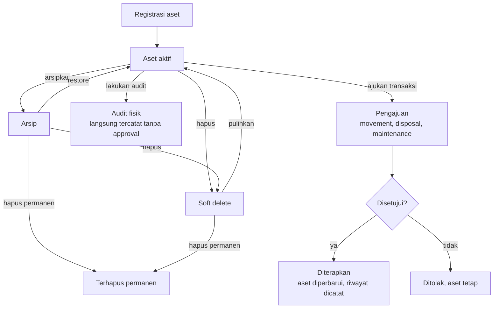

# PRD — Asset Management System

**Tanggal:** 13 November 2026

## 1. Ringkasan produk

Asset Management System adalah aplikasi web internal untuk mencatat, memantau, dan mengendalikan seluruh siklus hidup aset organisasi, dari pendaftaran sampai disposal atau arsip. Setiap perpindahan, disposal, dan maintenance melewati approval, dan setiap perubahan tercatat di riwayat aset.

Nilai utama bagi organisasi:

- **Satu sumber data aset** — kode unik, QR, RFID/NFC, foto, lokasi, departemen, pemakai, dan PIC dalam satu catatan.
- **Kontrol transaksi** — movement, disposal, dan maintenance baru berlaku setelah disetujui.
- **Jejak audit lengkap** — siapa mengubah apa dan kapan, termasuk arsip dan pemulihan.
- **Pelaporan siap pakai** — laporan aset, movement, disposal, audit dalam CSV, Excel, dan PDF, plus grafik KPI.
- **Efisiensi input** — impor massal XLSX/CSV dengan pratinjau dan validasi, serta aksi massal pada daftar aset.

## 2. Latar belakang & permasalahan

Pencatatan aset secara manual (spreadsheet, catatan terpisah per departemen) membuat posisi dan kondisi aset sulit dipastikan. Sistem ini dibangun untuk menjawab masalah berikut:

| Masalah | Dampak | Jawaban sistem |
| --- | --- | --- |
| Data aset tersebar dan tidak seragam | Duplikasi, kode ganda, data usang | Master data terpusat, kode dan QR token dibuat sistem |
| Perpindahan aset tidak terkontrol | Lokasi dan pemakai aktual tidak diketahui | Movement wajib approval, mencatat asal dan tujuan |
| Disposal tanpa jejak | Risiko kehilangan aset dan temuan audit | Disposal dan pembatalannya wajib alasan dan approval |
| Garansi dan maintenance terlewat | Biaya perbaikan naik, klaim garansi hangus | Endpoint alert garansi/maintenance ke webhook |
| Stock opname lambat | Selisih data fisik vs sistem | Audit fisik per aset + label QR |
| Input data awal berat | Onboarding aset lama memakan waktu | Impor massal dengan template dropdown dinamis |

## 3. Tujuan produk & metrik keberhasilan

Tujuan produk adalah data aset yang akurat, transaksi yang terkendali, dan audit yang bisa dipertanggungjawabkan. Angka target di bawah adalah usulan dan perlu disepakati pemilik produk.

| Tujuan | Metrik | Target usulan |
| --- | --- | --- |
| Data aset akurat | Selisih hasil audit fisik (MISMATCH + MISSING) terhadap total aset diaudit | < 2% per periode audit |
| Transaksi terkendali | Movement/disposal/maintenance yang berlaku tanpa approval | 0 |
| Approval cepat | Median waktu dari pengajuan ke keputusan | ≤ 2 hari kerja |
| Jejak audit lengkap | Perubahan aset yang tercatat di riwayat | 100% |
| Garansi terpantau | Garansi yang habis tanpa alert sebelumnya | 0 |
| Onboarding cepat | Baris impor massal yang lolos validasi pada percobaan pertama | ≥ 90% |

## 4. Pengguna, peran & hak akses

Akses diatur dengan RBAC berbasis database: hak efektif pengguna = gabungan permission dari role + permission langsung. Role `super-admin` melewati semua pengecekan, dan sistem mencegah penghapusan super-admin terakhir.

| Role | Persona | Permission |
| --- | --- | --- |
| super-admin | Administrator sistem / IT | Semua permission |
| asset-manager | Pengelola aset (GA / Finance aset) | assets.view, assets.manage, movements.manage, disposals.manage, maintenance.manage, audits.manage, reports.view, approvals.manage |
| auditor | Auditor internal / tim stock opname | assets.view, audits.manage, reports.view |
| maintenance | Teknisi / tim pemeliharaan | assets.view, maintenance.manage, movements.manage, reports.view |
| viewer | Manajemen / pimpinan unit | assets.view, reports.view |
| (publik, tanpa login) | Siapa pun yang memindai QR aset | Melihat subset data aset lewat `/asset-view/[token]` |

Selain pengguna login (`User`), sistem mengenal dua entitas orang lain yang tidak bisa login: **Asset User** (pemakai aset sehari-hari) dan **Person in Charge / PIC** (penanggung jawab aset).

## 5. Ruang lingkup

**Termasuk (in-scope)**

- Autentikasi email/password dan Google Sign-In (hanya email terdaftar), sesi 8 jam, serta lupa password via email.
- Manajemen pengguna, role, dan permission.
- Master data: status, kelas, satuan, departemen, PIC, Asset User, kategori (hierarki), lokasi (hierarki), garansi, kontrak vendor.
- Registrasi, edit, soft delete, arsip, dan restore aset, termasuk foto privat dan QR.
- Impor massal, update massal, hapus/arsip/restore massal.
- Transaksi movement, disposal (+ reverse), audit fisik, dan maintenance.
- Approval untuk movement, disposal, dan pembuatan maintenance.
- Riwayat aset, laporan, ekspor, label QR, dan grafik KPI.
- Alert garansi dan maintenance melalui endpoint cron + webhook.

**Tidak termasuk (out-of-scope) pada rilis ini**

- Integrasi perangkat pembaca RFID/NFC (tag hanya disimpan sebagai identitas).
- Perhitungan depresiasi otomatis dan integrasi akuntansi/ERP (metode depresiasi hanya disimpan).
- Notifikasi email dan inbox in-app.
- Remember me dan 2FA penuh.
- Pembatalan (cancel) pengajuan approval dan routing approver per departemen/nilai.
- Halaman pengaturan yang tersimpan (saat ini placeholder).
- Aplikasi mobile native dan API publik untuk pihak ketiga.

## 6. Kebutuhan fungsional

Prioritas: **P0** = wajib untuk operasional, **P1** = penting, **P2** = peningkatan. Status mengikuti implementasi saat ini.

### 6.1 Autentikasi & keamanan

| ID | Kebutuhan | Prioritas | Status |
| --- | --- | --- | --- |
| FR-AUTH-01 | Login email/password dengan hash bcrypt | P0 | Selesai |
| FR-AUTH-02 | Login Google; hanya email yang sudah terdaftar, tidak membuat akun baru | P1 | Selesai |
| FR-AUTH-03 | Sesi cookie HTTP-only bertanda tangan, berlaku 8 jam; logout menghapus cookie | P0 | Selesai |
| FR-AUTH-04 | CRUD pengguna, role, permission; assign role dan permission langsung | P0 | Selesai |
| FR-AUTH-05 | Mencegah penghapusan super-admin terakhir | P0 | Selesai |
| FR-AUTH-06 | Lupa password: tautan reset via email, token sekali pakai berlaku 60 menit, maks 3 permintaan per 15 menit per akun, respons tidak membocorkan email terdaftar, sesi lama otomatis keluar setelah reset | P1 | Selesai |
| FR-AUTH-07 | Remember me, 2FA | P2 | Belum |

### 6.2 Master data

| ID | Kebutuhan | Prioritas | Status |
| --- | --- | --- | --- |
| FR-MD-01 | CRUD status, kelas, satuan, departemen, PIC, Asset User, garansi, kontrak vendor (SLA respons/resolusi) | P0 | Selesai |
| FR-MD-02 | Kategori dan lokasi bersifat hierarki (parent–child) | P0 | Selesai |
| FR-MD-03 | Kode master unik; relasi ke aset di-set kosong saat master dihapus | P0 | Selesai |

### 6.3 Registrasi & pengelolaan aset

| ID | Kebutuhan | Prioritas | Status |
| --- | --- | --- | --- |
| FR-AST-01 | Daftar aset dengan pencarian, filter, paginasi server (10/25/50/100) | P0 | Selesai |
| FR-AST-02 | Tambah aset: kode berurutan dan QR token dibuat sistem, unik | P0 | Selesai |
| FR-AST-03 | Data aset: identitas, klasifikasi, lokasi, departemen, Asset User, PIC, pembelian, biaya, garansi, depresiasi, CAPEX/OPEX, kontrak vendor, RFID/NFC unik, consumable/pool + kuantitas | P0 | Selesai |
| FR-AST-04 | Detail aset dan halaman riwayat perubahan | P0 | Selesai |
| FR-AST-05 | Hapus aset = soft delete; foto dan riwayat tetap tersimpan | P0 | Selesai |
| FR-AST-06 | Foto aset wajib: aset tidak bisa ditambah tanpa foto, dan foto terakhir tidak bisa dihapus tanpa pengganti. JPG/PNG/WebP ≤ 10 MB dan ≤ 40 MP, dikompres ke WebP maks 1600 px, disimpan privat di Google Drive, diakses lewat endpoint berotorisasi | P1 | Selesai |
| FR-AST-07 | Halaman publik via QR menampilkan subset data aset tanpa login | P1 | Selesai |
| FR-AST-08 | Cetak label QR secara batch | P1 | Selesai |

### 6.4 Arsip aset

| ID | Kebutuhan | Prioritas | Status |
| --- | --- | --- | --- |
| FR-ARC-01 | Arsipkan aset (tunggal/massal) dengan alasan wajib dan tanggal retensi opsional; catat pelaku dan waktu | P1 | Selesai |
| FR-ARC-02 | Menu Archive punya dua tab: Diarsipkan dan Dihapus (soft delete); aset di keduanya keluar dari daftar aktif | P1 | Selesai |
| FR-ARC-03 | Pulihkan aset terarsip maupun terhapus ke daftar aktif (tunggal/massal); catat pelaku dan waktu | P1 | Selesai |
| FR-ARC-04 | Ekspor daftar arsip/terhapus sesuai filter | P2 | Selesai |
| FR-ARC-05 | Hapus permanen aset terarsip/terhapus (tunggal/massal, konfirmasi ketik HAPUS); foto, riwayat, dan transaksinya ikut terhapus; aset aktif tidak bisa dihapus permanen | P1 | Selesai |
| FR-ARC-06 | Master data yang masih dipakai aset tidak bisa dihapus; pesan menyebut berapa aset yang ada di Archive agar bisa dihapus permanen dulu | P1 | Selesai |

### 6.5 Operasi massal

| ID | Kebutuhan | Prioritas | Status |
| --- | --- | --- | --- |
| FR-BLK-01 | Unduh template XLSX dengan dropdown dari master data terkini | P1 | Selesai |
| FR-BLK-02 | Impor XLSX/CSV: pratinjau, validasi server, konfirmasi, keberhasilan parsial, laporan error XLSX | P1 | Selesai |
| FR-BLK-03 | Impor tidak boleh menimpa kode atau serial number yang sudah ada | P0 | Selesai |
| FR-BLK-04 | Pilih maks 200 aset di halaman aktif untuk update/hapus/arsip/restore massal | P1 | Selesai |
| FR-BLK-05 | Update massal memakai cek optimistik `updatedAt` agar tidak menimpa perubahan orang lain | P1 | Selesai |

### 6.6 Transaksi aset

| ID | Kebutuhan | Prioritas | Status |
| --- | --- | --- | --- |
| FR-TRX-01 | Movement: ubah lokasi, departemen, dan/atau Asset User; minimal satu tujuan berubah; ditolak untuk aset terhapus atau sedang disposal | P0 | Selesai |
| FR-TRX-02 | Disposal: alasan wajib; maksimal satu disposal aktif dan satu request pending per asset; setelah disetujui status jadi DISPOSED dan status sebelumnya disimpan saat approval | P0 | Selesai |
| FR-TRX-03 | Pembatalan (reverse) disposal wajib alasan dan approval; setelah disetujui status kembali ke status sebelum disposal (ACTIVE bila tidak diketahui); maksimal satu pembatalan pending per asset; status DISPOSED tidak bisa diubah manual | P1 | Selesai |
| FR-TRX-03a | Dropdown aset di form Disposal dan Movement hanya menampilkan aset yang bisa diproses (bukan disposed; Disposal juga tanpa request disposal pending) | P1 | Selesai |
| FR-TRX-04 | Audit fisik: hasil MATCHED/MISMATCH/MISSING/DAMAGED, lokasi, pelaku, catatan; langsung tercatat tanpa approval | P0 | Selesai |
| FR-TRX-05 | Maintenance: dibuat lewat approval; setelah ada dapat diubah, diselesaikan, atau dihapus | P1 | Selesai |

### 6.7 Approval

| ID | Kebutuhan | Prioritas | Status |
| --- | --- | --- | --- |
| FR-APV-01 | Pengajuan movement, disposal, maintenance masuk antrean pending | P0 | Selesai |
| FR-APV-02 | Pemegang `approvals.manage` dapat approve/reject; approve menerapkan transaksi | P0 | Selesai |
| FR-APV-03 | Alasan penolakan wajib diisi | P1 | Sebagian (opsional) |
| FR-APV-04 | Riwayat keputusan approval di UI | P1 | Sebagian |
| FR-APV-05 | Pengaju dapat membatalkan pengajuan | P2 | Belum |
| FR-APV-06 | Larangan self-approval dan penguncian saat approval bersamaan | P1 | Belum |

### 6.8 Laporan, grafik & alert

| ID | Kebutuhan | Prioritas | Status |
| --- | --- | --- | --- |
| FR-RPT-01 | Laporan aset, movement, disposal, audit dengan filter dan ekspor CSV | P0 | Selesai |
| FR-RPT-02 | Ekspor gabungan Excel dan PDF (PDF menampilkan maks 35 baris per tabel) | P1 | Selesai |
| FR-RPT-03 | Grafik KPI per status/kategori/lokasi dan tren movement/disposal 6 bulan | P1 | Selesai |
| FR-RPT-04 | Endpoint cron alert garansi dan maintenance, dikirim ke webhook opsional | P1 | Selesai |
| FR-RPT-05 | Notifikasi toast sukses/gagal dan dialog konfirmasi untuk aksi berisiko | P1 | Selesai |

## 7. Alur bisnis utama

Aset aktif adalah pusat siklus: dari sini aset bisa diarsipkan, dihapus (soft delete), diaudit, atau diajukan untuk transaksi yang menunggu approval.

Disposal yang disetujui mengubah status menjadi DISPOSED. Pembatalannya diajukan dengan alasan dan baru berlaku setelah disetujui. Aset terarsip dan aset soft delete dapat dipulihkan atau dihapus permanen dari menu Archive.

## 8. Model data utama

`Asset` adalah entitas inti; semua master merujuk ke aset dan semua transaksi menempel pada aset. Seluruh ID memakai UUID di PostgreSQL.

| Kelompok | Entitas | Catatan penting |
| --- | --- | --- |
| Inti | Asset | Kode, QR token, RFID, NFC unik; serial number belum unik; kolom arsip (archivedAt, alasan, retensi) dan soft delete (deletedAt) |
| Inti | AssetPhoto, DrivePhotoCleanup | Metadata foto; file di Google Drive; antrean pembersihan file yatim |
| Inti | AssetHistory | Log aksi + payload JSON per aset |
| Master | AssetStatus, AssetClass, Unit, AssetCategory, AssetLocation | Kategori dan lokasi berhierarki |
| Master | Department, PersonInCharge, AssetUser | Orang/organisasi yang terkait aset, terpisah dari akun login |
| Master | Warranty, VendorContract | Durasi garansi; kontrak + SLA vendor |
| Transaksi | AssetMovement | Snapshot asal dan tujuan (lokasi, departemen, Asset User) |
| Transaksi | AssetDisposal | Menyimpan status/lokasi/departemen sebelumnya untuk reverse |
| Transaksi | AssetAudit | Hasil audit fisik (enum AuditStatus) |
| Transaksi | AssetMaintenance | Pekerjaan pemeliharaan; status masih berupa teks |
| Workflow | AssetApprovalRequest | Tipe MOVEMENT/DISPOSAL/MAINTENANCE, status PENDING/APPROVED/REJECTED/CANCELLED, payload JSON |
| Workflow | AssetBulkJob | Pratinjau dan hasil impor/operasi massal, dengan masa kedaluwarsa |
| Keamanan | User, Role, Permission (+ tabel relasi) | RBAC lokal |
| Keamanan | PasswordResetToken | Hash token reset password, masa berlaku, waktu dipakai |

## 9. Kebutuhan non-fungsional & teknologi

| Aspek | Kebutuhan |
| --- | --- |
| Keamanan | Otorisasi diulang di server untuk setiap aksi, laporan, dan foto; cookie HTTP-only, SameSite=Lax, Secure di produksi; password bcrypt |
| Keamanan file | Foto tidak pernah dibuat publik; disajikan lewat endpoint berotorisasi dengan header no-store |
| Keamanan endpoint | Endpoint cron wajib dilindungi `CRON_SECRET` di produksi |
| Integritas data | Kode, QR, RFID, NFC unik; operasi massal tidak menimpa diam-diam; kompensasi file Drive jika simpan DB gagal |
| Auditabilitas | Setiap perubahan aset, arsip, restore, dan keputusan approval tercatat dengan pelaku dan waktu |
| Kinerja | Paginasi dan hitung data di server; seleksi massal maks 200; ukuran foto dibatasi |
| Usability | Antarmuka berbahasa Indonesia, toast umpan balik, dialog konfirmasi untuk aksi destruktif |
| Privasi | Halaman QR publik hanya menampilkan subset data yang aman |

**Stack teknologi**

| Lapisan | Teknologi |
| --- | --- |
| Frontend & backend | Next.js 15 (App Router, Server Components, Server Actions), React 19, TypeScript |
| Styling | Tailwind CSS 4 |
| Database | PostgreSQL via Prisma 7 |
| Penyimpanan file | Google Drive privat (OAuth refresh token) + Sharp untuk kompresi |
| Impor/ekspor | ExcelJS, xlsx, PDFKit, CSV |
| Deployment | Kompatibel Vercel; penjadwal eksternal untuk endpoint cron |

## 10. Asumsi, risiko & pertanyaan terbuka

**Asumsi**

- Semua pengguna login didaftarkan admin terlebih dahulu; Google Sign-In tidak membuat akun.
- Satu akun Google Drive organisasi menjadi pemilik penyimpanan foto.
- Penjadwal eksternal (mis. Vercel Cron) memanggil endpoint alert secara berkala.

**Risiko**

| Risiko | Dampak | Mitigasi usulan |
| --- | --- | --- |
| Self-approval dan approval bersamaan belum dicegah | Kontrol internal lemah, transaksi ganda | Tolak approve oleh pengaju; klaim request secara atomik |
| Approver bersifat global | Siapa pun dengan `approvals.manage` menyetujui semua | Routing approver per departemen atau nilai aset |
| Refresh token Drive milik satu orang | Foto tidak bisa diakses jika akun dicabut | Gunakan akun layanan/shared drive milik organisasi |
| Serial number tidak unik di CRUD biasa | Duplikasi data | Tetapkan aturan keunikan dan tambahkan constraint |
| Aset terarsip masih muncul di beberapa opsi transaksi/laporan | Transaksi pada aset nonaktif | Samakan cakupan "aset aktif" di semua query |
| Endpoint cron terbuka bila `CRON_SECRET` kosong | Kebocoran data alert | Wajibkan secret di produksi |
| Bulk job tidak dibersihkan otomatis | Data menumpuk | Job purge berkala setelah `expiresAt` |

**Pertanyaan terbuka**

- [ ] Apakah serial number harus unik global, per kategori, atau boleh ganda?
- [ ] Apa beda MATCH dan MATCHED pada status audit; apakah salah satu dihapus?
- [ ] Apakah alasan penolakan approval diwajibkan?
- [ ] Berapa lama retensi default untuk arsip, soft delete, riwayat, dan foto?
- [ ] Field apa saja yang boleh tampil di halaman QR publik?
- [ ] Apakah depresiasi perlu dihitung otomatis dan diintegrasikan ke sistem akuntansi?
- [ ] Apakah sistem akan berdiri sendiri atau diintegrasikan ke sistem induk (SSO, RBAC, master departemen/lokasi bersama)?
