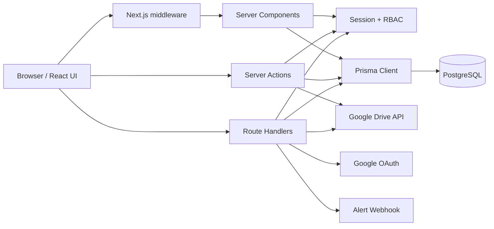
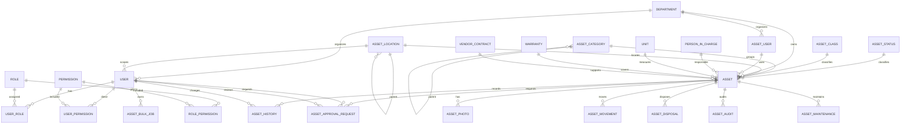

# Asset Management System — Reverse Engineering & Integration Analysis

**Audit date:** 8 October 2026  
**Scope:** source-code review only; no source change, migration, or production-data mutation.  
**Purpose:** describe the existing application and identify decisions required before embedding it as a module in another system.

## 1. Executive summary

The active application is a monolithic Next.js 15 App Router application written in TypeScript/React 19. Next.js Server Components render most pages, Client Components handle dialogs/forms, and Server Actions implement most writes. A small number of Route Handlers provide Google OAuth, private photo streaming, cron alerts, and downloadable reports. Data is stored in PostgreSQL through Prisma 7.

The repository also contains Laravel-oriented dependencies and environment keys. The inspected Asset dashboard, authentication, Prisma schema, and production build are Next.js-based; the Laravel configuration is legacy/co-located and is not the active implementation documented here.

The application currently owns its own users, password hashes, Google login, signed session cookie, roles, permissions, notifications, and Google Drive credentials. These are the largest integration concerns because a host system will usually already own identity, RBAC, UI shell, notifications, and secrets.

The core Asset domain is sufficiently separated at the data level, but it directly references the local `users`, `departments`, and permission system. Integration therefore requires explicit ownership and identifier-mapping decisions before code is moved.

## 2. Technology and architecture

| Area | Existing implementation | Notes for integration |
|---|---|---|
| Frontend | Next.js 15 App Router, React 19, TypeScript, Tailwind CSS 4 | Pages combine Server and Client Components. |
| Backend | Next.js Server Actions and Route Handlers | There is no separate REST service for most CRUD operations. |
| Database | PostgreSQL | `DATABASE_URL` is the Prisma connection string. |
| ORM | Prisma 7 with `@prisma/adapter-pg` | Generated client is stored under `src/generated/prisma`. |
| Authentication | Local email/password plus Google OAuth | Both resolve to the local `users` table. |
| Session | Signed HMAC token in an HTTP-only cookie | Stateless, eight-hour lifetime; signed with `AUTH_SECRET` or `APP_KEY`. |
| Authorization | Database RBAC: roles plus direct permissions | Backend actions call `requirePermission`; some sidebar utility links are not permission-filtered. |
| File storage | Private Google My Drive using OAuth refresh token | Image access is proxied through an authenticated backend endpoint. |
| Image processing | Sharp | Resize inside 1600×1600, WebP quality 78, no upscale, metadata removed. |
| Import/export | ExcelJS, xlsx, PDFKit, CSV | Templates are generated from current database master data. |
| UI feedback | Shared React toast provider and confirmation dialog | In-process UI only; there is no persistent notification table. |
| Deployment | Next.js/Vercel-compatible | No deployment-specific manifest was found; runtime environment must supply secrets and DB access. |

### Runtime architecture

## 3. Feature inventory

Legend: **Implemented**, **Partial**, **Placeholder**, or **Not implemented**.

| Area | Feature | Status | Actual behavior |
|---|---|---:|---|
| Authentication | Email/password login | Implemented | Bcrypt comparison against local `users.password`. |
| Authentication | Show/hide password | Implemented | Client-only field toggle. |
| Authentication | Google Sign In | Implemented | Server-side OAuth; only pre-registered local email may log in. |
| Authentication | Logout | Implemented | Deletes session cookie. |
| Authentication | Remember me | Not implemented | Checkbox is disabled. |
| Authentication | Forgot password | Not implemented | Text is displayed without a recovery flow. |
| Authentication | 2FA | Partial/schema only | User fields exist; no complete login challenge was found. |
| Security | User CRUD | Implemented | Local users, password hashing, role/direct-permission assignment. |
| Security | Role/permission CRUD | Implemented | RBAC records are database-backed. |
| Security | Last super-admin protection | Implemented | Server action prevents removal/deletion of the last super-admin. |
| Asset | List/search/filter/pagination | Implemented | Server-side count, limit, offset; active list excludes deleted and archived assets. |
| Asset | Create/view/edit | Implemented | System-generated sequential code and QR token. |
| Asset | Delete | Implemented | Soft delete via `deletedAt`. |
| Asset | Archive/restore | Implemented | Reason, actor, date, history, single and bulk actions. |
| Asset | Photo | Implemented | Validated/compressed WebP stored privately in Google Drive. |
| Asset | QR public view | Implemented | Token URL exposes a restricted subset without login. |
| Asset | RFID/NFC fields | Implemented as identifiers | Stored and unique; no reader integration was found. |
| Master data | Status/class/unit/department/PIC/user/category/location/warranty/vendor | Implemented | CRUD patterns vary slightly by master. Category/location support hierarchy. |
| Import | XLSX/CSV preview and confirmation | Implemented | Bounded parser, server validation, partial success, persisted preview job. |
| Import | Dynamic Excel dropdowns | Implemented | Reference Data is queried on each template download. |
| Import | Duplicate protection | Implemented for bulk | Code and nonempty serial; regular CRUD has no DB unique serial constraint. |
| Import | Error report | Implemented | XLSX result report. |
| Bulk | Select current page | Implemented | Maximum 200 selections; select-all is current page. |
| Bulk | Update/delete/archive/restore | Implemented | Delete is soft delete; archive/restore retain photos/history. |
| Transactions | Movement | Implemented through approval | Applies location, department, and/or Asset User after approval. |
| Transactions | Disposal/reverse | Implemented through approval | Approval sets status `DISPOSED`; reverse restores previous values. |
| Transactions | Physical audit | Implemented directly | Audit status, location, actor, notes, and history. |
| Maintenance | Create through approval | Implemented | Approved request creates maintenance. Existing maintenance can be updated/completed/deleted directly. |
| Approval | Request/pending/approve/reject | Implemented | Global `approvals.manage`; no assigned approver. |
| Approval | Reject reason | Partial | Field exists but reason is optional. |
| Approval | History/list of final decisions | Partial | Decision fields and AssetHistory exist; UI only lists pending requests. |
| Approval | Cancel/withdraw | Not implemented | Enum contains `CANCELLED`, but no transition/action exists. |
| Reports | Asset/movement/disposal/audit reports | Implemented | Filtered pages and CSV endpoints. |
| Reports | Combined Excel/PDF | Implemented | PDF caps display to first 35 rows per table. |
| Reports | QR labels | Implemented | Batch label generation UI. |
| Charts | KPI charts | Implemented | Status/category/location and six-month movement/disposal trends. |
| Alerts | Warranty/maintenance endpoint | Implemented | Cron Route Handler returns JSON and can POST to a webhook. |
| Notifications | Success/error toast | Implemented | Ephemeral browser feedback. |
| Notifications | Email/in-app inbox | Not implemented | Mail keys in legacy env do not represent an active Next.js mail workflow. |
| Settings | Settings screen | Placeholder | Static module-page configuration, no persisted settings backend. |

## 4. Module boundary

| Feature | Asset-specific | Shared/system-level | Notes |
|---|:---:|:---:|---|
| Asset core and lifecycle | Yes | No | Remains inside Asset module. |
| Category, class, status, unit, warranty | Yes | Possible | Strong candidates for Asset-owned reference data. |
| Asset location | Yes/conditional | Possible | May overlap with host facilities/location master. |
| Department | No/conditional | Yes | Usually host HR/organization data; currently owned locally. |
| Person in Charge / Asset User | Conditional | Yes | Duplicates person/user concepts and may need host identity mapping. |
| Movement, disposal, audit, maintenance | Yes | No | Domain workflows that should remain with Asset. |
| Approval | Conditional | Yes | Current workflow is Asset-specific but approval engines are often shared. |
| Authentication/session | No | Yes | Should normally be supplied by host system. |
| User/role/permission management | No | Yes | Current implementation is standalone RBAC. |
| Toast/confirmation UI | No | Yes | Reuse host design system if available. |
| Google Drive storage | Conditional | Yes | Asset-specific files, but credentials/storage abstraction may be shared. |
| Activity/audit history | Conditional | Yes | Asset events are domain-specific; audit infrastructure may be shared. |
| Pagination/table primitives | No | Yes | UI infrastructure. |
| Reports/export framework | Conditional | Yes | Datasets are Asset-specific; export engine can be host-provided. |
| Cron/webhook notification | Conditional | Yes | Alert rules are Asset-specific; scheduler/delivery is infrastructure. |

## 5. Dependency inventory

| Dependency | Used by | Current source | Integration concern |
|---|---|---|---|
| User identity | Sessions, history, archive, transactions, approvals, bulk jobs | Local `users` table | Host user IDs and lifecycle may differ. |
| Role and permission | Every protected page/action | Local RBAC tables | Permission names must be namespaced/mapped to host policy. |
| Department | Asset, Asset User, movement, disposal snapshot | Local `departments` | Likely duplicates host organization master. |
| Location | Asset, users, movement, audit, reports | Local `asset_locations` | Decide whether physical locations belong to Asset or host facilities. |
| Asset User | Assignment/movement | Local `asset_users` | Separate from login `User`; identity duplication needs resolution. |
| PIC | Asset responsibility | Local `person_in_charges` | Also separate from login `User`. |
| Google OAuth | Login | Google Cloud OAuth client | Should be removed/replaced if host provides SSO. |
| Google Drive OAuth | Photos | Folder ID + client secret + refresh token | Storage owner, token rotation, quota, and operational ownership. |
| Sharp | Image compression | Node native dependency | Deployment runtime must support native binary. |
| PostgreSQL/Prisma | All persistence | Local schema/client | Host migration ownership and table naming need agreement. |
| Toast/dialog | CRUD feedback | Local React components | Potential design-system duplication. |
| ExcelJS/xlsx/PDFKit | Import/export/report | npm dependencies | Bundle/runtime size and security patch ownership. |
| Webhook scheduler | Warranty and maintenance alerts | Route Handler + external scheduler | Host scheduler and notification bus may replace it. |

## 6. Data ownership

| Entity | Current owner | Used by Asset module | Potential host owner | Notes |
|---|---|---:|---|---|
| User | This application | Yes | Host IAM | Strong integration candidate. |
| Role/Permission | This application | Yes | Host IAM/RBAC | Needs permission mapping. |
| Department | This application | Yes | Host HR/organization | Needs confirmation. |
| Asset Location | This application | Yes | Asset or host facilities | Needs confirmation. |
| Asset Class/Category/Status/Unit | This application | Yes | Asset module | Likely remain Asset-owned. |
| PIC | This application | Yes | Host HR/directory | Needs confirmation. |
| Asset User | This application | Yes | Host HR/directory | Needs confirmation; currently distinct from User. |
| Asset | This application | Yes | Asset module | Core aggregate root. |
| Warranty/Vendor Contract | This application | Yes | Asset/procurement | Potential procurement integration. |
| Movement/Disposal/Audit/Maintenance | This application | Yes | Asset module | Core domain transactions. |
| Approval Request | This application | Yes | Host workflow or Asset | Decide whether to adopt host approval engine. |
| Asset History | This application | Yes | Asset module/shared audit | Domain log should be retained. |
| Asset Photo metadata | This application | Yes | Asset module | Binary is in Google Drive. |
| Bulk Job | This application | Yes | Asset module | Temporary preview plus audit result. |
| Notification | No persistent owner | Limited | Host notification service | Current implementation is toast/webhook only. |

## 7. Authentication integration

### Current flow

1. Middleware checks only whether the session cookie exists for `/dashboard/*`.
2. The protected page/action calls `getCurrentUser`, which verifies the signed session token and reloads the user, roles, and permissions from PostgreSQL.
3. Email/password login compares bcrypt hashes.
4. Google OAuth validates state, nonce, token signature/claims, verified email, then looks up that email in local `users`.
5. Successful login sets an HTTP-only, `SameSite=Lax` cookie; production cookies are `Secure`.
6. Logout deletes the cookie.

**INTEGRATION CONCERN:** this is a complete standalone authentication boundary. Keeping it unchanged inside a host system would produce duplicated users and potentially a second login. The integration must decide whether to consume host session claims, exchange host tokens, or map an external subject to a local Asset actor record.

Password recovery, enabled remember-me, and a complete 2FA challenge are not implemented and should not be presented as reusable finished features.

## 8. Authorization integration

Effective permissions are the union of role permissions and direct user permissions. The `super-admin` role bypasses named checks. Server actions enforce permissions; frontend visibility is supplementary.

| Permission | Current use | Integration concern |
|---|---|---|
| `assets.view` | Asset/archive/detail/photo access | Define host equivalent and data scope. |
| `assets.manage` | Asset/master/bulk/archive mutations | Broad permission; host may require create/update/delete separation. |
| `movements.manage` | Submit movement, movement pages | Request submission and administration are combined. |
| `disposals.manage` | Submit/reverse disposal | Reverse is sensitive and may need a separate grant. |
| `audits.manage` | Physical audit records | Consider auditor scope/location restriction. |
| `maintenance.manage` | Request and direct maintenance edits | Creation approval and post-creation mutation policy need alignment. |
| `reports.view` | Reports and exports | Export may need a separate permission. |
| `approvals.manage` | Approve/reject all Asset requests | No assignee/department/value scope; self-approval currently possible. |
| `users.manage` | User CRUD | Should likely remain host-owned. |
| `roles.manage` | Role CRUD | Should likely remain host-owned. |
| `permissions.manage` | Permission CRUD | Should likely remain host-owned. |
| `settings.manage` | Settings access | Settings page is currently a placeholder. |

Known approval concerns to preserve in integration planning: no self-approval guard, no atomic request claim under concurrent approval, no assigned approver, and rejection reason is optional.

## 9. Database inventory

All primary domain IDs are UUIDs. Many master relations use `ON DELETE SET NULL`; transaction-to-Asset relations generally cascade.

| Table | Purpose | Asset-specific | Shared candidate | Key constraints/concerns |
|---|---|:---:|:---:|---|
| `users` | Login identity and actor | No | Yes | Unique email; local password/2FA fields. |
| `roles`, `permissions` | RBAC catalogs | No | Yes | Unique `(name, guard_name)`. |
| `user_roles`, `role_permissions`, `user_permissions` | RBAC joins | No | Yes | Composite primary keys. |
| `asset_statuses` | Asset lifecycle status | Yes | No | Unique code. |
| `asset_classes` | Classification | Yes | No | Unique code. |
| `units` | Measurement unit | Yes | Possible | Unique symbol. |
| `departments` | Organizational department | Conditional | Yes | Unique code; likely host-owned. |
| `person_in_charges` | Responsible people | Conditional | Yes | No unique email. |
| `asset_users` | Operational assignees | Conditional | Yes | Separate from `users`; nullable department. |
| `asset_categories` | Hierarchical category | Yes | No | Unique code; self-referencing parent. |
| `asset_locations` | Hierarchical physical location | Conditional | Possible | Unique code; self-referencing parent. |
| `warranties` | Warranty catalog | Yes | Possible | Name is not unique. |
| `vendor_contracts` | Vendor/SLA details | Conditional | Possible | Potential procurement overlap. |
| `assets` | Core Asset aggregate | Yes | No | Unique code, QR token, RFID, NFC; serial is not unique. |
| `asset_bulk_jobs` | Import/update/delete preview/result | Yes | No | User ownership, JSON rows, expiry; no automatic purge. |
| `asset_histories` | Asset activity history | Yes | Possible | Free-text action plus JSON payload. |
| `asset_photos` | Private photo metadata | Yes | No | Unique Drive file ID; binary external. |
| `drive_photo_cleanup` | Durable Drive compensation queue | Infrastructure | Possible | Prevents orphan files. |
| `asset_movements` | Assignment/location transitions | Yes | No | Stores from/to snapshots. |
| `asset_disposals` | End-of-life transactions | Yes | No | Supports reverse and prior state. |
| `asset_audits` | Physical audit results | Yes | No | Enum status, location, actor. |
| `asset_maintenances` | Maintenance work | Yes | Possible | String status rather than enum. |
| `asset_approval_requests` | Pending/final workflow request | Conditional | Possible | JSON payload; no approval event table/index/assignee. |

### Important enums

- `AuditStatus`: `MATCH`, `MATCHED`, `MISMATCH`, `MISSING`, `DAMAGED`. Both `MATCH` and `MATCHED` exist and need semantic confirmation.
- `ApprovalStatus`: `PENDING`, `APPROVED`, `REJECTED`, `CANCELLED`; cancel flow is absent.
- `ApprovalTransactionType`: `MOVEMENT`, `DISPOSAL`, `MAINTENANCE`.
- `TransactionStatus` exists but is not the status type of the three transaction tables.
- `DepreciationMethod`: straight line, declining balance, units of activity, none.
- `CapexOpex`: CAPEX or OPEX.

## 10. Data model (ERD)

## 11. Backend and route inventory

### UI routes

- `/login`, `/dashboard`
- `/dashboard/assets`, `/dashboard/assets/[id]`, `/dashboard/assets/[id]/history`
- `/dashboard/archive`
- `/dashboard/master/[masterPage]`
- `/dashboard/transactions/movements`, `/disposals`, `/audits`
- `/dashboard/maintenance`, `/dashboard/approvals`
- `/dashboard/reports/*`, `/dashboard/charts`
- `/dashboard/security`, `/users`, `/roles`, `/permissions`
- `/asset-view/[token]` public restricted QR view

### Route Handlers

| Route | Method | Purpose | Protection |
|---|---|---|---|
| `/api/auth/google` | GET | Begin OAuth | State/nonce cookies and configuration checks. |
| `/api/auth/google/callback` | GET | Verify OAuth and create session | Google verification plus registered local email. |
| `/api/assets/[id]/photos/[photoId]` | GET | Stream private Drive photo | Session + `assets.view`; private no-store response. |
| `/api/cron/asset-alerts` | GET | Warranty/maintenance alert payload/webhook | Bearer/query secret only when `CRON_SECRET` is configured. |
| `/dashboard/*/export` | GET | CSV/XLSX/PDF download | Corresponding server permission check. |

Most CRUD operations are Server Actions. A host frontend that is not Next.js cannot directly treat these as a stable public API; an explicit service/API boundary would be required.

## 12. Business rules that must be preserved

1. Asset code and QR token are system-generated and unique.
2. RFID and NFC tags are unique when present.
3. Asset delete is soft delete; photos and history remain referenced.
4. Archive is reversible, stores reason/actor/time, and excludes records from the active list.
5. Drive files are private and served through authorization; files are not made public by link.
6. Photo input is a real image, at most 10 MB and 40 MP, JPG/PNG/WebP, non-animated; output is WebP up to 1600 px, quality 78.
7. Failed DB attachment after Drive upload is compensated through `drive_photo_cleanup`.
8. Movement requires at least one changed destination and is blocked for active disposal/deleted assets.
9. Disposal requires a reason and `DISPOSED` master status; approval applies status and stores prior state for reverse.
10. Movement, disposal, and maintenance creation require approval before operational records are created.
11. Physical audit writes directly and records AssetHistory.
12. Bulk import never silently overwrites existing code/serial; preview precedes confirmation.
13. Bulk update is limited to selected records and uses optimistic `updatedAt` checks.
14. Bulk delete is soft delete.
15. Template master dropdowns are generated from current database values and map names back to foreign keys.
16. Pagination uses 10/25/50/100 page sizes and server-side count/offset on implemented lists.
17. Report/photo endpoints repeat authorization on the backend.

## 13. Environment and external services

### Active Next.js variables

| Variable | Purpose | Sensitivity |
|---|---|---|
| `DATABASE_URL` | PostgreSQL connection | Secret |
| `AUTH_SECRET` or `APP_KEY` | Session HMAC key | Secret |
| `GOOGLE_CLIENT_ID` | Google login OAuth client | Configuration |
| `GOOGLE_CLIENT_SECRET` | Google login OAuth secret | Secret |
| `GOOGLE_REDIRECT_URI` | Exact login callback | Configuration |
| `GOOGLE_DRIVE_FOLDER_ID` | Asset photo folder | Internal configuration |
| `GOOGLE_DRIVE_CLIENT_ID` | Storage-owner OAuth client | Configuration |
| `GOOGLE_DRIVE_CLIENT_SECRET` | Storage OAuth secret | Secret |
| `GOOGLE_DRIVE_REFRESH_TOKEN` | My Drive access | High-value secret |
| `CRON_SECRET` | Protect alert endpoint | Secret; should be mandatory in production |
| `ASSET_ALERT_WEBHOOK_URL` | Optional webhook delivery | Secret/internal URL |
| `SEED_ADMIN_PASSWORD` | Seed-only admin password | Secret/non-production tooling |

The current `.env.example` also contains Laravel, mail, Redis, AWS, and Vite values. They are not evidence that the active Next.js Asset module uses those services. Split or clean the environment contract during integration to prevent false dependencies.

## 14. Integration concerns and potential conflicts

| ID | Concern | Impact |
|---|---|---|
| INT-01 | Standalone session and login | Double login and duplicate identity unless replaced/mapped. |
| INT-02 | Local User/Role/Permission tables | Conflicting user IDs, roles, lifecycle, and policy ownership. |
| INT-03 | Three person concepts (`User`, `AssetUser`, `PIC`) | Ambiguous identity mapping and duplicated personal data. |
| INT-04 | Local Department/Location | Duplicate masters and synchronization requirements. |
| INT-05 | Server Actions as backend boundary | Difficult reuse by a non-Next.js host or mobile/third-party client. |
| INT-06 | Global CSS/sidebar/dashboard shell | Route, navigation, theme, and layout collision with host shell. |
| INT-07 | Unnamespaced permission strings | Possible collision with host permissions. |
| INT-08 | Google Drive tied to one My Drive owner | Token rotation, employee departure, quota, and ownership risk. |
| INT-09 | Public QR token route | Host routing and public-data policy must be reconciled. |
| INT-10 | Approval engine is local and has known concurrency/self-approval gaps | Decide whether to harden or replace with host workflow. |
| INT-11 | AssetHistory is free-form action/JSON | Mapping to a structured host audit log may lose semantics. |
| INT-12 | Serial uniqueness differs by flow | Bulk rejects duplicate serials, database/individual CRUD do not enforce uniqueness. |
| INT-13 | Archived assets remain visible to some transaction/report option queries | Host integration should define consistent active-record scope. |
| INT-14 | Legacy Laravel dependencies/configuration coexist | Build ownership and dependency cleanup need a deliberate boundary. |
| INT-15 | Cron endpoint is open when `CRON_SECRET` is absent | Production configuration must enforce a secret or host scheduler authentication. |

## 15. Decisions required before integration

1. What framework/runtime and navigation model does the host use?
2. Will Asset be embedded in the same deployment, mounted as a route group, or run as a separate service?
3. Which system owns user identity and sessions?
4. What stable host user identifier will replace/map local UUIDs?
5. Will existing Asset users be migrated, linked, or retired?
6. Are `AssetUser` and `PersonInCharge` host employees, external contacts, or Asset-owned records?
7. Which system owns Department and physical Location?
8. Should permissions be namespaced, for example `asset.assets.view`, and split into create/update/delete/export/reverse?
9. Does the host already provide an approval engine, audit service, notification service, scheduler, and storage abstraction?
10. Must historical actor names survive deletion/deactivation of host users?
11. Will Google Drive remain storage, and who owns its OAuth refresh token?
12. Is the public QR view allowed under the host security policy?
13. Is serial number globally unique, unique per category/vendor, or intentionally non-unique?
14. Which timezone/currency/date rules come from the host?
15. How will schema migrations and table prefixes/names be owned?
16. What data must be migrated and what downtime/rollback policy applies?
17. Should approvals prohibit self-approval and use department/value-based routing?
18. What retention policy applies to bulk jobs, history, photos, archive, and soft-deleted records?

## 16. Suggested integration workstreams (analysis, not implementation)

1. **Contract discovery:** document host auth claims, RBAC, people/department/location identifiers, design system, API conventions, and deployment constraints.
2. **Ownership decision:** approve the entity ownership table and synchronization direction.
3. **Boundary design:** decide in-process Next.js module versus service/API boundary.
4. **Identity mapping:** define immutable actor references and migration of existing history.
5. **Schema strategy:** choose shared schema, prefixed tables, or separate database; define migration authority.
6. **Infrastructure adapters:** authentication, authorization, storage, notification, scheduler, audit, and exports.
7. **Domain migration:** retain Asset lifecycle rules and transaction history while replacing shared infrastructure.
8. **Parallel verification:** reconcile counts, photos, history, role access, reports, and approval outcomes before cutover.

## 17. Source map

| Concern | Primary source |
|---|---|
| Database model | `prisma/schema.prisma`, `prisma/migrations/*` |
| Session/RBAC | `src/lib/session-core.ts`, `src/lib/auth.ts`, `middleware.ts` |
| Login | `src/app/login/*`, `src/lib/google-oauth.ts`, `src/app/api/auth/google/*` |
| Asset CRUD/archive | `src/app/(dashboard)/dashboard/assets/*`, `archive/*` |
| Photos | `src/lib/asset-image.ts`, `asset-photo-storage.ts`, `google-drive.ts` |
| Bulk | `src/lib/asset-bulk*.ts`, `src/components/assets/asset-bulk-client.tsx` |
| Transactions | `src/app/(dashboard)/dashboard/transactions/transaction-actions.ts` |
| Approval | `src/app/(dashboard)/dashboard/approvals/*` |
| Reports | `src/lib/basic-reports.ts`, `advanced-report-export.ts`, report routes |
| UI shell | `src/components/layout/*`, `src/app/globals.css` |
| Environment | `.env.example`, `src/lib/env.ts`, `prisma.config.ts` |

## 18. Verification limits

This document is based on the repository state reviewed on 8 October 2026. No production database rows, Google Drive contents, Vercel settings, OAuth console settings, webhook receiver, or host-system source code were inspected. Items involving actual data volume, production role assignments, external quotas, host ownership, and deployment topology therefore remain **Needs confirmation**.
